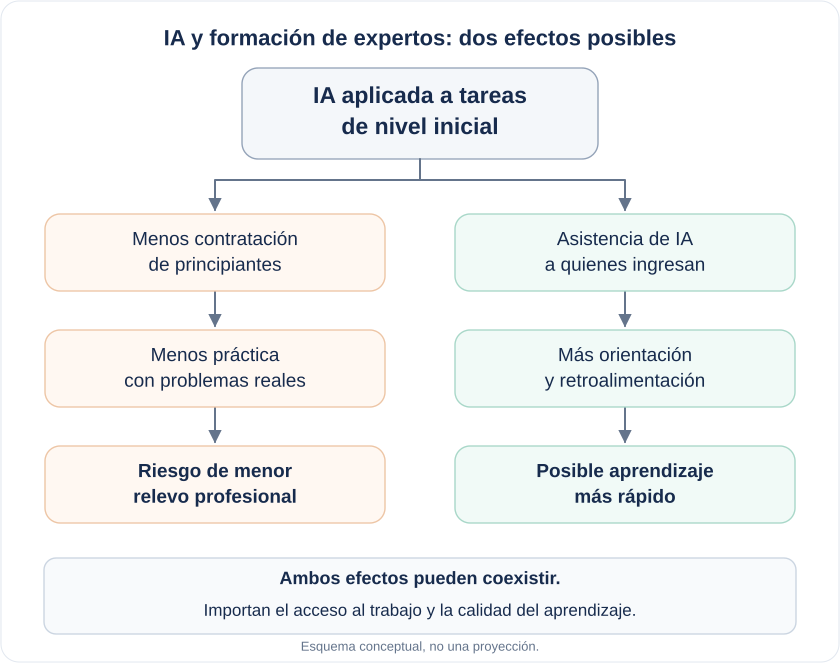

Imaginemos una reunión de presupuesto en una empresa de software. Los ingenieros más experimentados acaban de incorporar asistentes de inteligencia artificial. Resuelven problemas más rápido, escriben código con menos esfuerzo y necesitan menos apoyo para las tareas rutinarias. Alguien plantea una pregunta perfectamente razonable: si el equipo puede producir más con las personas que ya tiene, ¿para qué abrir nuevas vacantes junior?

La decisión parece buena. Este año la empresa ahorra dinero y entrega sus proyectos a tiempo.

Pero hay algo que no aparece en esa planilla de costos: esos principiantes que hoy parecen prescindibles son parte de los expertos que la empresa podría necesitar mañana.

La pregunta importa porque ya estamos observando señales de que las oportunidades de entrada se están estrechando en algunas ocupaciones.

Erik Brynjolfsson, Bharat Chandar y Ruyu Chen analizaron datos de nóminas de millones de trabajadores estadounidenses hasta junio de 2026. Encontraron que el empleo de jóvenes de 22 a 25 años en ocupaciones muy expuestas a la IA estaba un 19% por debajo de la trayectoria que habría seguido si hubiera evolucionado como el de jóvenes en ocupaciones menos expuestas. Entre trabajadores experimentados no observaron una brecha comparable. La diferencia se explica principalmente por una menor contratación, no por una ola de despidos (Brynjolfsson et al., 2026).

Otro estudio, realizado por Samuel Westby, Alicia Sasser Modestino y Peiran Cheng, examinó las ofertas laborales de desarrolladores de software en Estados Unidos. Después de la llegada de ChatGPT, las vacantes junior disminuyeron entre un 14% y un 15% en relación con las senior. Parte del cambio ocurrió dentro de los mismos cargos: las empresas comenzaron a exigir más años de experiencia para puestos que seguían teniendo el mismo nombre (Westby et al., 2026).

Estos resultados no demuestran que la IA sea la única causa. El estudio de Stanford reconoce tendencias previas y diferencias de composición educativa que complican la interpretación. Tampoco estamos hablando de un colapso general del empleo, y la evidencia proviene sobre todo de Estados Unidos. Pero la señal es suficientemente importante para mirar más allá del siguiente proceso de contratación.

¿Qué se pierde cuando desaparece una vacante junior?

Un desarrollador recién contratado puede pasar semanas corrigiendo errores menores, leyendo código ajeno o documentando decisiones que otra persona tomó. Desde la perspectiva de la productividad inmediata, algunas de esas tareas parecen candidatas ideales para la automatización.

Para quien recién comienza, sin embargo, también son una forma de aprender. Al corregir un error descubre por qué falló una solución aparentemente correcta. Al revisar el trabajo de alguien más reconoce problemas que todavía no sabe anticipar. Al recibir retroalimentación empieza a distinguir qué decisiones requieren criterio y cuáles admiten una regla.

La experiencia profesional no llega automáticamente con los años. Se construye enfrentando problemas reales, equivocándose, recibiendo correcciones y asumiendo responsabilidades cada vez mayores. Muchas tareas pequeñas proporcionan precisamente esas oportunidades.

Un estudio cualitativo reciente de Sumin Yu y Taesup Moon exploró esta tensión mediante entrevistas a 14 personas vinculadas al desarrollo de software en Corea del Sur. Los autores describen cómo ciertas tareas de entrada pueden desplazarse hacia equipos formados por seniors asistidos por IA, reduciendo las oportunidades de aprendizaje práctico de los juniors (Yu y Moon, 2026). Las entrevistas no permiten proyectar una futura escasez de expertos, pero ayudan a identificar el proceso que habría que observar.

Aquí aparece una paradoja organizacional.

Una empresa puede ganar eficiencia dejando de formar principiantes y contratando profesionales con experiencia cuando los necesita. Para ella, puede ser una estrategia racional. Pero ¿qué ocurre si muchas organizaciones hacen lo mismo?

Los expertos no aparecen espontáneamente en el mercado laboral. Se forman en empresas, equipos, instituciones y comunidades de práctica. Cada organización que deja de invertir en ese aprendizaje puede beneficiarse de la experiencia creada por otras. Si demasiadas siguen ese camino, el conjunto termina invirtiendo menos en la formación de la siguiente generación.

Es un problema de coordinación con consecuencias demoradas. El ahorro se registra este trimestre. El costo, si aparece, podría hacerlo años después, cuando haya que reemplazar a quienes se jubilan o se trasladan a otros trabajos.

Sin embargo, hay otra posibilidad que sería un error ignorar: la IA también puede acelerar la formación de quienes sí consiguen entrar.

En una investigación publicada en *The Quarterly Journal of Economics*, Brynjolfsson, Danielle Li y Lindsey Raymond estudiaron el uso de un asistente de IA entre 5.172 agentes de atención al cliente. La productividad aumentó un 15% en promedio, con beneficios particularmente pronunciados entre los trabajadores menos experimentados. También encontraron evidencia de aprendizaje asociado al uso de la herramienta (Brynjolfsson et al., 2025).

Eso cambia el diagnóstico. La IA puede quitar tareas que antes permitían aprender, pero también puede enseñar, ofrecer retroalimentación y acercar a un principiante a prácticas que antes solo dominaban sus colegas más experimentados. El resultado dependerá de qué tareas se automaticen, cuáles permanezcan bajo responsabilidad humana y cómo se organice el aprendizaje.

*Esquema conceptual. Ambos mecanismos pueden coexistir y todavía no sabemos cuál dominará.*

Tampoco sabemos si las empresas necesitarán la misma cantidad de seniors en el futuro. Algunas funciones cambiarán y ciertas competencias podrán adquirirse más rápido. Predecir hoy una escasez inevitable sería ir más lejos de lo que permite la evidencia.

La pregunta útil es más concreta: ¿estamos automatizando el trabajo de entrada más rápido de lo que estamos creando nuevas maneras de adquirir experiencia?

Responderla requiere que las empresas midan algo que casi nunca aparece en sus indicadores de adopción de IA. Además de tareas completadas, tiempo ahorrado y reducción de costos, deberían observar cuántas personas nuevas logran incorporarse, qué responsabilidades aprenden a asumir y cuánto tardan en resolver problemas complejos con autonomía.

No necesitamos conservar trabajos repetitivos solo para mantener ocupados a los principiantes. Podemos diseñar experiencias mejores: proyectos graduales con problemas reales, revisión de decisiones por profesionales experimentados y herramientas de IA que ayuden a comprender los errores en lugar de ocultarlos. Eso cuesta tiempo y recursos. Formar expertos siempre los ha costado.

Por ahora, los estudios muestran un mercado de entrada bajo presión y dos mecanismos que podrían operar en direcciones opuestas: menos oportunidades de practicar y más capacidad de aprender con asistencia. El balance todavía está abierto.

Pero la decisión de reducir la contratación junior ya se está tomando en muchas organizaciones, mientras sus consecuencias de largo plazo siguen fuera de las planillas.

Cuando llegue el momento de reemplazar a un experto, no bastará con publicar una oferta que pida diez años de experiencia. Alguien tendrá que haber tenido, durante esos diez años, la oportunidad de adquirirla.

## Referencias

Brynjolfsson, E., Chandar, B., & Chen, R. (2026). *Canaries in the Coal Mine? Six Facts about the Recent Employment Effects of Artificial Intelligence*. Stanford Digital Economy Lab, versión revisada de agosto de 2026. [Ver estudio](https://digitaleconomy.stanford.edu/publication/canaries-in-the-coal-mine-six-facts-about-the-recent-employment-effects-of-artificial-intelligence/).

Westby, S., Modestino, A. S., & Cheng, P. (2026). *Generative AI and the Redefinition of Entry-Level Software Work*. IZA Discussion Paper No. 18723. [Ver estudio](https://www.iza.org/publications/dp/18723).

Tucker, L. (2026). *You're (not) Hired: Artificial Intelligence and Early Career Hiring in the Quarterly Workforce Indicators*. U.S. Census Bureau, CES-26-27. [Ver estudio](https://lehd.ces.census.gov/applications/creat/paper-profile/1415).

Yu, S., & Moon, T. (2026). *Who Will Become the Next Senior? How Generative AI Erodes the Development Pathway in Software Engineering*. Preprint, arXiv:2607.17067. [Ver estudio](https://arxiv.org/abs/2607.17067).

Brynjolfsson, E., Li, D., & Raymond, L. (2025). Generative AI at Work. *The Quarterly Journal of Economics, 140*(2), 889–942. [Ver artículo](https://doi.org/10.1093/qje/qjae044).
